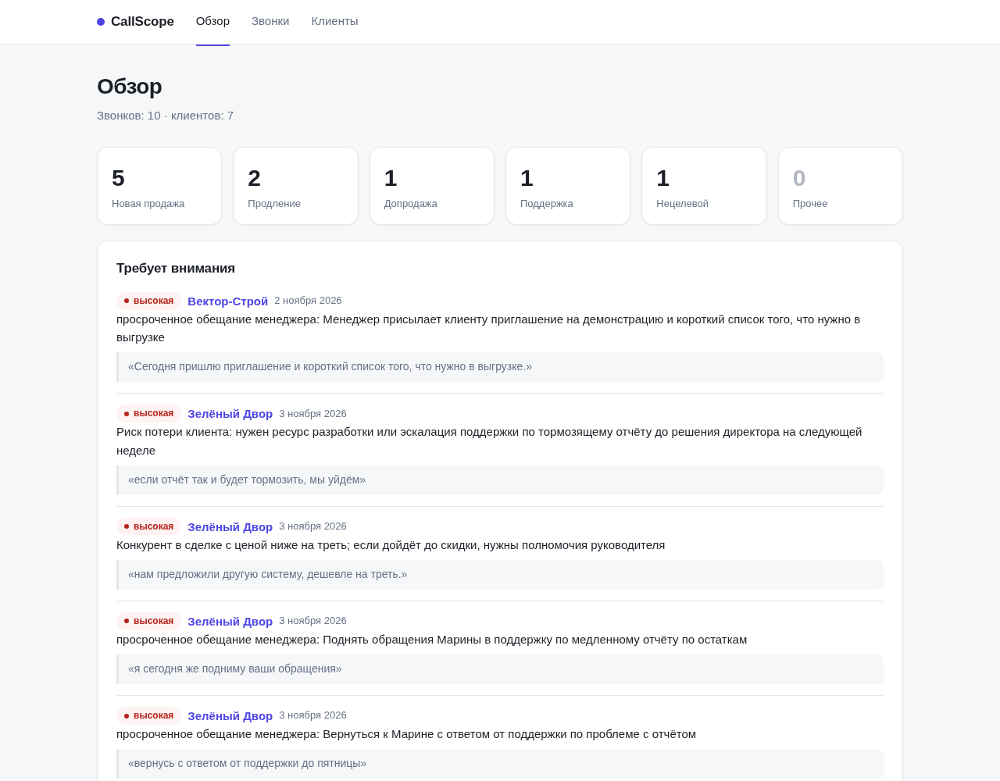
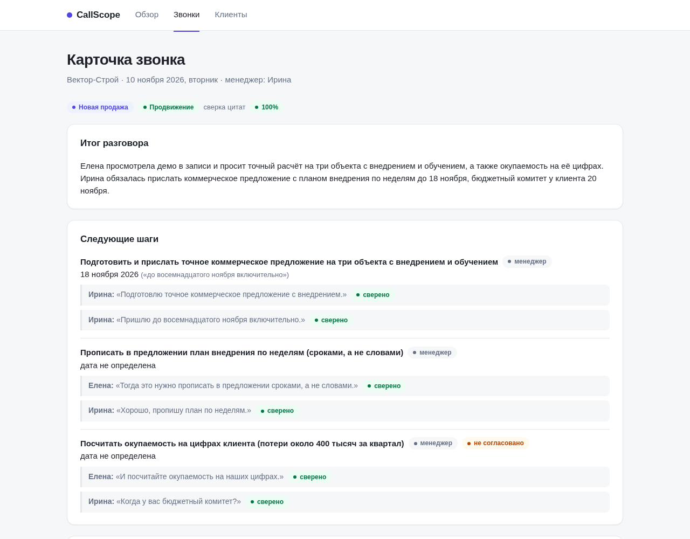
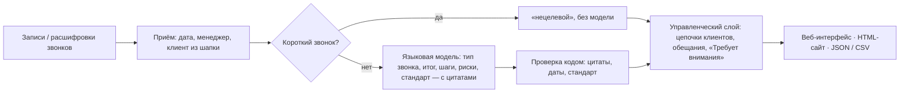

# CallScope — разбор звонков отдела продаж

**CallScope превращает записи разговоров менеджеров в понятные руководителю действия:
что обещали клиенту, где клиент собирается уйти, какие сделки буксуют и где менеджер
отступил от продажного стандарта. Каждый вывод подтверждён дословной цитатой из разговора.**



> Все данные в репозитории синтетические: вымышленная компания «ТехноПоток» и её клиенты.
> Демо открывается без ключей и без обращения к модели.

---

## Какую задачу решает

Руководитель отдела продаж физически не может прослушать сотни звонков в неделю.
В итоге он узнаёт о проблеме, когда клиент уже ушёл:

- менеджер пообещал прислать расчёт «до пятницы» и забыл;
- клиент прямо сказал «если не заработает — уйдём», а до руководителя это не дошло;
- на первом звонке менеджер перечислил функции вместо того, чтобы выяснить потребность;
- цену назвали «около двухсот тысяч», а клиенту для бюджетного комитета нужна точная.

CallScope каждый день разбирает все звонки и показывает только то, что требует действия.

## Что получает руководитель

| Экран | Что на нём |
|---|---|
| **Обзор** | звонки по типам, список «Требует внимания» с приоритетом, частые отступления от стандарта, обещания менеджеров со сроками |
| **Звонки** | все разговоры с фильтром по типу: новая продажа, продление, поддержка, допродажа, нецелевой |
| **Карточка звонка** | итог, следующие шаги с датами, потребности, риски, ошибки менеджера, чек-лист продажного стандарта и расшифровка с подсвеченными цитатами |
| **Клиенты** | история по каждому клиенту: все звонки цепочкой, чем закончился последний |



## Главный принцип: модель извлекает смысл, код проверяет факты

Языковые модели пересказывают убедительно, но иногда додумывают. Для руководителя
выдуманный «клиент согласился» хуже, чем отсутствие отчёта. Поэтому:

1. **Каждое утверждение несёт цитату.** Модель обязана приложить дословный фрагмент
   разговора к каждой потребности, риску, шагу и оценке по стандарту.
2. **Цитату проверяет код, а не модель.** Если фрагмента нет в расшифровке, пункт
   помечается «не сверено» и не попадает в списки для руководителя.
3. **Даты считает код.** «До восемнадцатого», «в следующий вторник», «после двадцатого»
   разбирает детерминированный резолвер от даты звонка. Если модель подставила точную
   дату там, где в разговоре назван только месяц, она убирается с пометкой.
4. **Неясное остаётся неясным.** Нет доказательства, что менеджер выполнил пункт
   стандарта, значит «неясно», а не «выполнено».
5. **Пустые звонки бесплатны.** Короткие разговоры («ошиблись номером») отмечаются
   как нецелевые без обращения к модели.

## Как это работает



Управленческий слой (цепочки, просроченные обещания, приоритеты) — обычный код без
модели: его выводы воспроизводимы и одинаковы при каждом запуске.

## Языковая модель — заменяемая

Провайдер выбирается флагом `--provider`, весь остальной конвейер от него не зависит.

| Провайдер | Когда использовать |
|---|---|
| `claude` | Claude Code CLI, удобно для разработки и демо |
| `openai` | любой OpenAI-совместимый API: адрес задаётся `LLM_BASE_URL`, ключ — `LLM_API_KEY` |
| **российский контур** | YandexGPT (Yandex AI Studio) или GigaChat — через OpenAI-совместимый адрес или отдельный адаптер на ~50 строк в `callscope/providers.py` |
| локальная модель | vLLM / Ollama через OpenAI-совместимый адрес — данные не покидают сервер компании |

Если служба безопасности запрещает передавать записи за рубеж, меняется одна строка
настройки, а не код. Распознавание речи (например, Yandex SpeechKit) подключается так же
отдельным адаптером перед этапом разбора.

## Продажный стандарт настраивается

Критерии лежат в [`callscope/standard.yaml`](callscope/standard.yaml) и проверяются только
на звонках «новая продажа». По умолчанию:

- выявил потребность и боль клиента;
- выяснил, кто принимает решение;
- презентовал под потребность, а не списком функций;
- договорился о конкретном шаге с датой;
- не называл цену «около», когда клиент ждёт расчёт;
- отработал возражение.

Под свою компанию стандарт меняется правкой этого файла.

## Быстрый старт

Нужен Python 3.12 и [uv](https://docs.astral.sh/uv/).

```bash
git clone https://github.com/Ali-Jabowr/callscope && cd callscope
uv sync

# веб-интерфейс на готовом разборе 10 демо-звонков — без ключей и без модели
uv run python -m callscope serve --source demo/analysis.json --as-of 2026-11-12
# открыть http://127.0.0.1:8000

# то же самое статическим сайтом, который можно отправить файлом
uv run python -m callscope site --source demo/analysis.json --as-of 2026-11-12 -o site

# полный прогон через модель
uv run python -m callscope run demo/transcripts -o out --provider claude:sonnet

# сверка результата с ручным эталоном
uv run python -m callscope eval --source out/analysis.json
```

## Качество: эталон и тесты

- [`demo/gold.yaml`](demo/gold.yaml) — ручной эталон по 10 демо-звонкам: итоги, даты,
  ключевые потребности и риски. `callscope eval` показывает, где модель расходится с ним. На демо-наборе: 92 из 99 проверок (93%); расхождения — в спорных итогах вроде «перенос» против «продвижение».
- 179 автотестов: резолвер дат, проверка цитат, стандарт, управленческий слой,
  веб-интерфейс. В тестах модель всегда подменяется — они не тратят деньги и не зависят от сети.
- Проверка качества кода одной командой: `./.claude/verify.sh`
  (ruff, mypy в строгом режиме, pytest, pip-audit), та же проверка — в CI.

## Ограничения

- На вход подаются расшифровки. Распознавание речи — отдельный адаптер под выбранного
  провайдера.
- Привязка звонков к клиенту идёт по названию компании в шапке разговора; интеграция
  с CRM — следующий шаг внедрения.
- Ключевые слова для риска ухода клиента — на русском языке и настраиваются в коде.
- Оценки по стандарту — подсказка руководителю, а не автоматический KPI менеджера.

## Внедрение под вашу компанию

Типовой пилот — 2–3 недели: подключение выгрузки звонков из вашей телефонии или CRM,
распознавание речи, ваш продажный стандарт, выбор провайдера модели (включая российский
контур или локальный сервер), ручной эталон на ваших звонках и прогон исторического массива.

Связаться: через [профиль на GitHub](https://github.com/Ali-Jabowr).

---

Лицензия: все права защищены. Код открыт для ознакомления; коммерческое использование — по договорённости.
